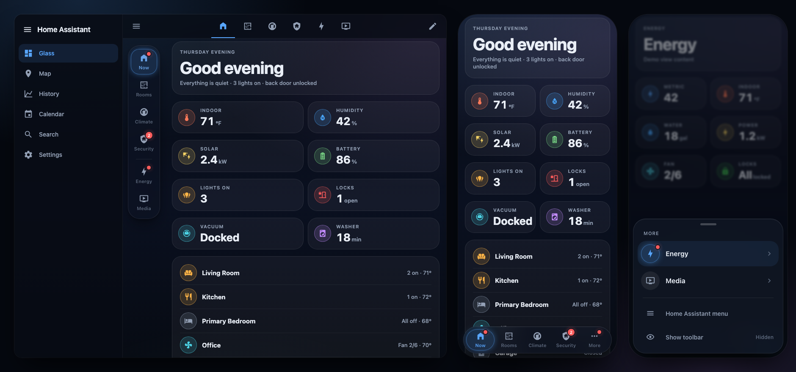

# Glasshouse Nav Card

App-like navigation for multi-view Home Assistant dashboards. On a phone (including the Home Assistant
companion app on iPhone) it becomes a floating, frosted tab bar with a **More** sheet; on desktop it is a
slim rail beside your content (or a centred segmented bar on top). Part of the **Glasshouse** suite:
refined dark glass, one accent, calm surfaces.



## Features

- **Phone (below `mobile_breakpoint`)**: a floating pill-shaped tab bar fixed to the bottom of the screen,
  aware of the iPhone safe area. Up to five tabs; the active tab sits in an accent pill that slides between
  tabs with a short spring (180 ms, off with *reduce motion*). Re-tapping the active tab scrolls to the top.
- **More sheet**: when you list `more` routes (or have more than five), a **More** tab opens a frosted
  bottom sheet with large rows. Close it by tapping outside, dragging the handle down, or pressing Escape.
  When Home Assistant's toolbar is hidden, the sheet also offers **Home Assistant menu** (opens the sidebar)
  and **Show toolbar** (brings the toolbar back until you navigate, so you can reach edit mode).
- **Desktop**: a slim vertical rail on the left edge of the dashboard area (never over Home Assistant's
  sidebar), or with `layout: top` a centred segmented bar under the toolbar. All routes are shown, `more`
  routes after a divider. The dashboard content is pushed aside so nothing is covered.
- **Badges**: any route can show a dot (entity is `on`) or a count (numeric state above 0) from an entity.
  If a route in the More sheet has a badge, the More tab shows a dot.
- **Hides Home Assistant's toolbar on phones** (`hide_header: auto`) for a full-screen app feel, and
  restores it on desktop, in edit mode, and when the card is removed.
- Uses Home Assistant's own navigation (`history.pushState` + `location-changed`), so views switch
  instantly with no reload, and Back / Forward work.
- Invisible in the normal flow: put it in a view's footer or any section.
- Keyboard and screen-reader friendly (`<nav>`, `aria-current="page"`, focus rings). No dependencies,
  no build step: one JavaScript file.

## Installation

### HACS (custom repository)

1. HACS → ⋮ → **Custom repositories**.
2. Add `https://github.com/petergCA/glasshouse-nav-card` with type **Dashboard**.
3. Install **Glasshouse Nav Card**, then reload the browser (and pull to refresh in the companion app).

### Manual

1. Copy `glasshouse-nav-card.js` to `config/www/`.
2. Settings → Dashboards → ⋮ → **Resources** → add `/local/glasshouse-nav-card.js` as a
   **JavaScript module**.

For the full look, pair it with the **Glasshouse** theme.

## Where to put it

Add the card to **every view** that should show the navigation, with the same configuration. The best
place is the sections view **footer**, so it sits at the end of the page:

```yaml
views:
  - title: Now
    path: home
    type: sections
    sections: [ ... ]
    footer:
      card:
        type: custom:glasshouse-nav-card
        routes: [ ... ]   # same config on every view
```

In a YAML-mode dashboard you can define the card once with an anchor (`card: &nav {...}`) and reuse it
(`card: *nav`). It also works in any section of a sections view, or in a masonry view.

Moving between views hands the bar over to the next view's card without flicker. Navigating to a
dashboard or panel without the card removes the bar and restores everything it changed.

## Configuration

| Option | Type | Default | Description |
|---|---|---|---|
| `type` | string | **required** | `custom:glasshouse-nav-card` |
| `routes` | list | **required** | The main tabs, in order (see below). |
| `more` | list | none | Extra routes. On phones they live in the **More** sheet; on desktop after a divider. |
| `mobile_breakpoint` | number | `768` | Window width in px below which the phone tab bar is used. |
| `layout` | `rail` / `top` / `none` | `rail` | Desktop style: left rail, centred segmented bar on top, or `none` (phones only: nothing is shown or pushed at or above the breakpoint, e.g. when Home Assistant's own view tabs are enough). |
| `hide_header` | `auto` / `true` / `false` | `auto` | `auto` hides Home Assistant's toolbar on phones only; `true` always; `false` never. Never hidden in edit mode. |
| `side_rail` | boolean | `true` | On phones with a wide side safe-area (≥ 56 px, e.g. a status strip along one edge), stand the tab bar up vertically inside that strip instead of along the bottom. |
| `push` | boolean | `true` | Make room for the bar (bottom spacer on phones, left/top padding on desktop). |
| `accent` | CSS colour | `--gh-info` | Accent of the active tab. |
| `menu_button` | boolean | `true` | Add *Home Assistant menu* and *Show toolbar* rows to the More sheet while the toolbar is hidden. |
| `more_label` | string | `More` | Label of the More tab. |
| `more_icon` | string | `mdi:dots-horizontal` | Icon of the More tab. |

Each route:

| Option | Type | Description |
|---|---|---|
| `path` | string | **Required.** A view path (`rooms`), which navigates within the current dashboard (`/<dashboard>/rooms`), or an absolute path starting with `/` (`/energy`, `/other-dashboard/main`). View indexes (`0`, `1`) work too. |
| `label` | string | Tab label. |
| `icon` | string | `mdi:` icon. A route needs an icon or a label. |
| `badge` | entity id | Optional. Dot when the state is `on`, count when it is a number above 0 (`99+` cap). |
| `color` | CSS colour | Optional accent for this route only. |

A route is active when the last segment of the address matches its `path` (absolute routes: the whole
path). On the dashboard root (no view in the address) the first route is active.

## Example

```yaml
type: custom:glasshouse-nav-card
routes:
  - path: home
    label: Now
    icon: mdi:home-variant
    badge: binary_sensor.anything_alerting
  - path: rooms
    label: Rooms
    icon: mdi:floor-plan
  - path: climate
    label: Climate
    icon: mdi:thermostat
  - path: security
    label: Security
    icon: mdi:shield-home
    badge: sensor.open_doors
more:
  - path: energy
    label: Energy
    icon: mdi:lightning-bolt
  - path: media
    label: Media
    icon: mdi:television-play
mobile_breakpoint: 768
hide_header: auto
```

Desktop top bar instead of the rail, and a custom accent:

```yaml
type: custom:glasshouse-nav-card
layout: top
accent: "#c48cff"
routes: [ ... ]
```

## Theming and CSS variables

All Glasshouse tokens (`--glasshouse-*`) apply. Specific to this card:

| Variable | Default | Use |
|---|---|---|
| `--glasshouse-nav-bg` | `rgba(14,19,30,0.7)` | Bar and rail background (blurred behind). |
| `--glasshouse-nav-sheet-bg` | `rgba(16,22,34,0.86)` | More sheet background. |
| `--glasshouse-nav-accent` | `--gh-info` | Accent (the `accent` option wins). |
| `--glasshouse-nav-z` | `4` | Stacking order of the bar (Home Assistant's toolbar uses 4). |
| `--glasshouse-nav-sheet-z` | `8` | Stacking order of the sheet and its backdrop. |

The card publishes on `<html>`:

- `--gh-nav-height`: the space the phone bar takes, including the safe area (`0px` on desktop). Use it in
  your own CSS, for example `padding-bottom: var(--gh-nav-height)` on something fixed to the bottom.
- `--gh-nav-offset-left`: the width taken by the desktop rail (`0px` otherwise).

## How it works (and what it assumes about Home Assistant)

- The bar, rail and sheet are drawn in one `<glasshouse-nav-portal>` element appended to `<body>`, with
  `position: fixed`. Living outside the dashboard means no card, section or theme effect (transforms,
  filters) can break fixed positioning or clip it. The card itself is a zero-height element (or a spacer).
- **Rail position**: measured from the dashboard view (`hui-view`) with `getBoundingClientRect`, updated on
  resize and whenever the view's size changes (for example when the sidebar collapses). If no view is found,
  it falls back to `left: var(--mdc-drawer-width)`.
- **Making room**: on desktop the card sets an inline `padding-left` (rail) or `padding-top` (top bar) on
  the `hui-view` element. On phones the card becomes a spacer of `--gh-nav-height` when it is in the view
  footer; elsewhere it sets `padding-bottom: var(--gh-nav-height)` on `hui-view`. Previous inline values
  are restored when it leaves. Turn this off with `push: false`.
- **Hiding the toolbar**: a small `<style>` is added inside `hui-root`'s shadow root that hides `.header`
  and sets `--header-height: 0px`. `hui-root` is found by walking up from the card (falling back to
  `home-assistant` → `home-assistant-main` → `ha-panel-lovelace` → `hui-root`). All of this is wrapped in
  `try/catch`: if a future Home Assistant release changes these names, the card keeps working as a
  floating bar and simply leaves the toolbar alone.
- **Edit mode** is detected from the card's `editMode`/`preview` flags, `hui-root`'s `lovelace.editMode`,
  or `?edit=1`. While editing, the toolbar stays visible and the card shows a small placeholder so you can
  select it. In the card picker and editor preview the bar is drawn inline.

## Development

`test/harness.html` fakes the Home Assistant page structure above (sidebar, toolbar, sections view and
footer) with demo content and badge entities. `test/shot.sh` serves the repo over local http and takes
headless Chrome screenshots: `PAGE=phone` gives a true 390 px viewport, `?sheet` opens the More sheet,
`?layout=top`, `?path=<view>`, `?go=<tab>` and `?edit` cover the other states. `test/nav.test.cjs` runs
in Node with jsdom and covers route matching, the navigation event, badges, header hide/restore,
breakpoint switching, padding restore and teardown.

## License

MIT © 2026 Peter Gray
